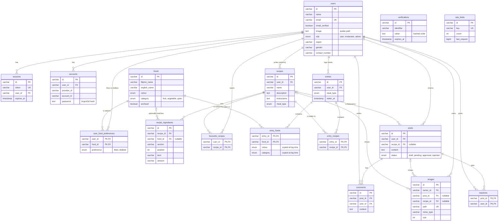

# PalettePlate database diagram

Generated from `src/db/schema.ts`. GitHub draws the diagram below automatically.
`PK` is a primary key, `FK` a foreign key, `UK` a unique column. Timestamps and long text columns are left out to keep it readable.

## Reading it

- **`users` is the hub.** Almost everything a person does hangs off it, and deleting a user cascades to their sessions, meals, posts, comments and hearts. Their uploaded `images` are the exception: those are restricted, so the files are cleaned up first.
- **Food log:** `entries` is one meal. `entry_foods` and `entry_recipes` are its join tables. `entry_foods` copies the food's color and category when logged, so history stays right if a food is later reclassified.
- **Cookbook:** `recipes` are written by admins. `recipe_ingredients` is free text, with an optional link to `foods`.
- **Feed:** `posts` have `comments` and `reactions`. A post's photo is a row in `images` pointing at it, and an avatar is an `images` row with no post, referenced from `users.image`.
- **Standalone tables:** `verifications` (email codes) and `rate_limits` have no foreign keys.
- **Deletes:** A recipe can't be deleted while a meal uses it, and a food can't be deleted while a meal or recipe uses it (`restrict`). A deleted recipe leaves its posts in place (`set null`).
